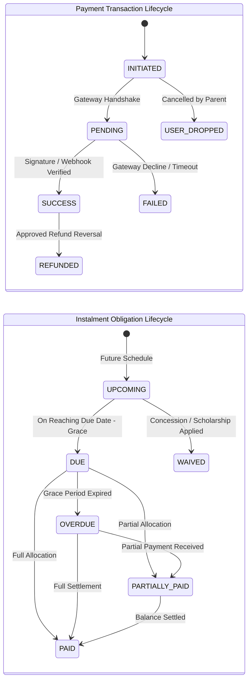

# BUSINESS RULES & FINANCIAL POLICIES SPECIFICATION
**Project:** Coaching Institute Fee Tracking System & Parent Portal  
**Target:** Company A, Jaipur  
**Version:** 1.0.0 (Production Financial Architecture)  

---

## 1. Core Financial Principles

### 1.1 Integer Paise Representation (Zero Floating-Point Drift)
- All monetary representations in memory, database storage, API contracts, and calculations are strictly integers representing Indian **paise** (`₹1.00 = 100 paise`).
- Example:
  - Average Annual Fee: `₹1,20,000` -> `12000000` paise.
  - Aarav Meena Sample Dues: `₹30,000` -> `3000000` paise.
  - Ishita Sharma Paid Amount: `₹15,000` -> `1500000` paise.
- Currency formatting for display (`Intl.NumberFormat('en-IN', { style: 'currency', currency: 'INR' })`) is executed only at the presentation layer (UI) or PDF rendering boundary.

### 1.2 Separation of Transaction Status vs. Instalment Status vs. Student Status
To prevent financial race conditions and data corruption, three distinct state machines govern the lifecycle:

- **Payment Transaction Status**: Represents the technical state of an attempted money transfer.
  - `INITIATED`: Order created with gateway or draft voucher created.
  - `PENDING`: Awaiting gateway callback or offline instrument (cheque) clearance.
  - `SUCCESS`: Money captured and cryptographically verified.
  - `FAILED`: Transaction rejected by bank, card issuer, or gateway.
  - `USER_DROPPED`: Parent dismissed payment sheet before completion.
  - `REFUNDED`: Funds returned to payer via refund flow.
- **Instalment Due Status**: Represents the student's legal payment obligation milestone.
  - `UPCOMING`: Due date is more than $N$ days in the future.
  - `DUE`: Milestone is active and within acceptable payment window.
  - `PARTIALLY_PAID`: $0 < \text{Settled Amount} < \text{Payable Amount}$.
  - `PAID`: $\text{Settled Amount} = \text{Payable Amount}$.
  - `OVERDUE`: Current date exceeds due date + grace period and balance $> 0$.
  - `WAIVED`: Full milestone forgiven via approved institutional scholarship/grant.
- **Student Enrolment Status**:
  - `ACTIVE`: Fully enrolled student in good standing.
  - `PROVISIONAL`: Admitted with pending documentation or first instalment verification.
  - `DROPOUT_RISK`: Flagged by predictive scoring for accounts and counsellor outreach.
  - `WITHDRAWN`: Formally withdrawn with completed or processed exit/refund.
  - `COMPLETED`: Academic session concluded.

### 1.3 Immutable Double-Entry Ledger
No financial transaction record or ledger entry may be modified or deleted (`UPDATE` or `DELETE` prohibited via database triggers/RLS on `fee_ledger`).
- A debit entry (`DEBIT`) increases student receivable (liability to institute).
- A credit entry (`CREDIT`) decreases student receivable (settlement via payment or approved waiver).
- Total Student Balance = $\sum \text{Debits} - \sum \text{Credits}$.

---

## 2. Payment Allocation Rules

When a payment of amount $A$ is successfully captured for a student:

1. **Targeted Allocation vs. FIFO Fallback**:
   - If the parent explicitly selects an instalment milestone in the UI, the payment is first allocated to that specific instalment up to its remaining balance.
   - If no milestone is selected (or if the payment amount exceeds the target instalment's balance), the system uses **FIFO (First In, First Out)** by instalment due date:
     1. Oldest `OVERDUE` instalment settled first.
     2. Then oldest `PARTIALLY_PAID` instalment.
     3. Then `DUE` instalment.
     4. Then future `UPCOMING` instalments.
2. **Partial Payments**:
   - Allowed down to a configurable minimum threshold (default: ₹1,000 / 100,000 paise).
   - The instalment status becomes `PARTIALLY_PAID`.
   - Remaining balance = $\text{Net Payable} - \text{Total Allocated Payments}$.
3. **Excess Payments / Advance Credit**:
   - If payment amount exceeds total current dues, the surplus funds are credited as `UNALLOCATED_ADVANCE` in the student's ledger and automatically linked to the immediate next scheduled instalment.
4. **Idempotency Guarantee**:
   - Every payment processing request requires a client-generated UUID `idempotency_key` or gateway `payment_id`. Repeated submissions with the same key return the cached successful result without duplicate ledger debit/credit postings.

---

## 3. Instalment Schedule Rules & Assignment Ambiguity Handling

### 3.1 Known Facts from Assignment Prompt
- Annual average fee: ~₹1,20,000.
- Collected in **3 or 4 instalments**.
- Actual sample data provided:
  - `STU-0412` | Aarav Meena | JEE 2027 Morning | Due Date: 2026-10-10 | Fee: ₹30,000 | Paid: ₹30,000
  - `STU-0587` | Ishita Sharma | JEE 2027 Evening | Due Date: 2026-10-10 | Fee: ₹30,000 | Paid: ₹15,000
  - `STU-0219` | Mohit Gurjar | NEET 2027 Morning | Due Date: 2026-11-15 | Fee: ₹40,000 | Paid: ₹0

### 3.2 Ambiguity Identification & Configurable Default Design
The assignment prompt leaves several operational parameters unspecified. In accordance with senior architectural standards, **we do not invent or hardcode these numbers**; instead, we formulate them as configurable parameters with documented fallback defaults:

| Parameter | Ambiguity Identified | Production Architectural Solution | Fallback Default |
| :--- | :--- | :--- | :--- |
| **Instalment Split** | Whether 3 or 4 instalments apply to which batch/stream, and what percentage per instalment. | Model as configurable `fee_plan_templates`. The sample figures (₹30k, ₹30k, ₹40k) indicate instalment amounts rather than total annual fees. | **Template A (4-Instalments):** 25%, 25%, 25%, 25% **Template B (3-Instalments):** 40%, 30%, 30% |
| **Grace Period** | Number of days after due date before overdue status and reminders escalate. | Configurable parameter `instalment_grace_period_days` stored in institute settings table. | **5 calendar days** |
| **GST / Tax Slab** | Whether ₹1,20,000 is inclusive or exclusive of GST, and whether education exemption applies. | Configurable parameter `tax_rate_basis_points` (e.g. 1800 for 18% GST, 0 for exempt) and `tax_inclusive_flag`. | **0% (Exempt/Inclusive)** pending institute confirmation |
| **Late Fee Penalty** | Whether overdue instalments accrue a daily or flat late fine. | Configurable parameter `late_fee_type` (`NONE`, `FLAT`, `DAILY_PERCENTAGE`). | **`NONE` (Disabled)** unless explicitly activated |
| **Centres' Official Names** | 4 centres are in Jaipur, but specific branch locations are not named. | Stored as dynamic records in `centres` table with administrative aliases. | Initialized as `Jaipur Centre 1`, `Jaipur Centre 2`, `Jaipur Centre 3`, `Jaipur Centre 4` |
| **Parent Mobile Numbers** | Sample student records do not supply parent phone numbers for OTP auth. | Stored as configurable / mock credentials for testing and dev seed. | Provided as test phone numbers in dev seed fixture: e.g. `98290XXXXX` linked to the 3 students |

---

## 4. Refund Calculation Rules

### 4.1 Policy Deduction Architecture
Refund calculation is one of the current primary pain points (calculated manually and subject to dispute). The system implements an auditable, rule-based formula:

$$\text{Net Refundable} = \text{Total Fee Collected} - \text{Non-Refundable Reg Fee} - \text{Prorated Tuition Consumed} - \text{Material Kit Charge} - \text{Processing Admin Fee}$$

Where:
- $\text{Total Fee Collected}$: Sum of all settled ledger credits for this student.
- $\text{Non-Refundable Reg Fee}$: Fixed initial admission/registration charge.
- $\text{Prorated Tuition Consumed}$:
  $$\text{Tuition Portion} \times \left( \frac{\min(\text{Days Attended / Days Elapsed}, \text{Total Session Days})}{\text{Total Session Days}} \right)$$
- $\text{Material Kit Charge}$: Retained if course books/study modules were handed over.
- $\text{Processing Admin Fee}$: Fixed cancellation fee.

### 4.2 Refund Ambiguity Handling
Because Company A has not provided their specific refund deduction schedule, the refund calculator accepts configurable policy profiles:
- **Policy Tier 1 (Within 15 days of batch start)**: 100% Tuition refund minus registration charge.
- **Policy Tier 2 (16–30 days of batch start)**: 75% Tuition refund minus registration and material charge.
- **Policy Tier 3 (31–60 days of batch start)**: 50% Tuition refund.
- **Policy Tier 4 (>60 days)**: 0% refund (Except on medical/special approval).
*All refund calculations present an editable breakdown to the Accounts Executive with mandatory rationale logging.*

---

## 5. Automated Reminders & Escalation Cadence

### 5.1 Trigger Timeline

1. **T-7 Days (Soft Notice)**: Informative notification with quick payment link.
2. **T-1 Day (Gentle Reminder)**: Reminder that due date is tomorrow.
3. **T-Day (Due Date Alert)**: Payment due notification with breakdown.
4. **T+3 Days (Grace Period Final Notice)**: Notification that grace period is concluding.
5. **T+7 Days (Overdue Escalation)**: Overdue alert with accounts contact details.
6. **T+15 Days (Critical Alert & Dropout Flag)**: Automated reminder ceases to avoid harassment; task created in Accounts Executive queue for personal counselling.

### 5.2 Anti-Spam & Quiet Hours Rules
- No reminder messages dispatched between **20:00 (8:00 PM)** and **09:00 (9:00 AM)** IST.
- Maximum 1 automated reminder per student within any 48-hour rolling window.
- If a payment is in `PENDING` status (e.g. cheque clearance), automated reminders are temporarily paused for that instalment.

---

## 6. Dropout-Risk Scoring Rules

The system calculates a normalized **Dropout Risk Score** ($0.0 \text{ to } 1.0$) using three objective signals:

$$\text{Risk Score} = (0.50 \times S_{\text{financial}}) + (0.30 \times S_{\text{attendance}}) + (0.20 \times S_{\text{academic}})$$

1. **Financial Risk ($S_{\text{financial}}$)**:
   - Days overdue $\le 0$: 0.0
   - Days overdue 1–15: 0.3
   - Days overdue 16–30: 0.7
   - Days overdue $>30$: 1.0
2. **Attendance Risk ($S_{\text{attendance}}$)**:
   - 30-day attendance $\ge 85\%$: 0.0
   - 30-day attendance $70\% - 84\%$: 0.5
   - 30-day attendance $< 70\%$: 1.0
3. **Academic Risk ($S_{\text{academic}}$)**:
   - Attended recent test and scored above 40th percentile: 0.0
   - Scored below 30th percentile: 0.5
   - Absent for 2 or more consecutive scheduled tests: 1.0

- **Threshold Classification**:
  - Score $\ge 0.70$: `HIGH_RISK` (Red badge, prioritized for counsellor intervention).
  - Score $0.40 - 0.69$: `MODERATE_RISK` (Yellow badge).
  - Score $< 0.40$: `LOW_RISK` (Normal).

---

## 7. Sample Data Grounding

In strict compliance with assignment guidelines, no extra student records or fabricated personal identities are created. The system seeds and tests with the exact three supplied student records:

| Student ID | Full Name | Batch | Instalment Due Date | Instalment Due | Settled Amount | Outstanding |
| :--- | :--- | :--- | :---: | :---: | :---: | :---: |
| **STU-0412** | Aarav Meena | JEE 2027 Morning | 2026-10-10 | ₹30,000 (3,000,000p) | ₹30,000 (3,000,000p) | ₹0 |
| **STU-0587** | Ishita Sharma | JEE 2027 Evening | 2026-10-10 | ₹30,000 (3,000,000p) | ₹15,000 (1,500,000p) | ₹15,000 (1,500,000p) |
| **STU-0219** | Mohit Gurjar | NEET 2027 Morning | 2026-11-15 | ₹40,000 (4,000,000p) | ₹0 | ₹40,000 (4,000,000p) |

*Note: The fee values above represent specific instalment dues, while total course fees follow the standard fee plan of ~₹1,20,000.*

