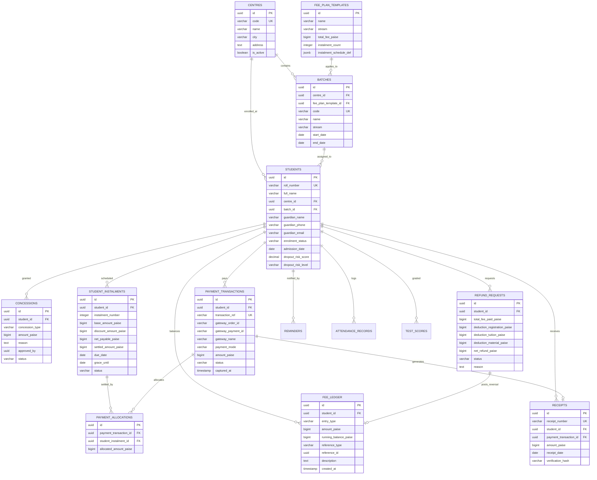

# DATABASE DESIGN SPECIFICATION
**Project:** Coaching Institute Fee Tracking System & Parent Portal  
**Target:** Company A, Jaipur  
**Engine:** Supabase PostgreSQL 15+  
**Currency Standard:** 64-bit Integer Paise (`BIGINT`)  

---

## 1. Entity-Relationship Diagram (ERD)



---

## 2. Table Schemas & Data Types

### 2.1 Academic & Organizational Tables

#### `centres`
Represents the 4 operational coaching centres of Company A in Jaipur.
```sql
CREATE TABLE centres (
    id UUID PRIMARY KEY DEFAULT gen_random_uuid(),
    code VARCHAR(30) NOT NULL UNIQUE,       -- e.g. 'JPR-C1', 'JPR-C2'
    name VARCHAR(150) NOT NULL,             -- e.g. 'Jaipur Centre 1 (Malviya Nagar)'
    city VARCHAR(100) NOT NULL DEFAULT 'Jaipur',
    address TEXT,
    contact_phone VARCHAR(20),
    is_active BOOLEAN NOT NULL DEFAULT true,
    created_at TIMESTAMPTZ NOT NULL DEFAULT clock_timestamp(),
    updated_at TIMESTAMPTZ NOT NULL DEFAULT clock_timestamp()
);
```

#### `fee_plan_templates`
Defines standard annual fee structure configurations (e.g. ₹1,20,000 in 3 or 4 instalments).
```sql
CREATE TABLE fee_plan_templates (
    id UUID PRIMARY KEY DEFAULT gen_random_uuid(),
    name VARCHAR(120) NOT NULL,             -- e.g. 'JEE 2-Year Comprehensive Plan 2027'
    stream VARCHAR(50) NOT NULL,            -- 'JEE' | 'NEET' | 'FOUNDATION'
    academic_year VARCHAR(20) NOT NULL,     -- '2026-2027'
    total_fee_paise BIGINT NOT NULL CHECK (total_fee_paise > 0), -- e.g. 12000000 (₹1,20,000)
    instalment_count INT NOT NULL CHECK (instalment_count BETWEEN 1 AND 12),
    schedule_definition JSONB NOT NULL,     -- Array of { instalmentNumber, percentage, relativeDueDays }
    is_active BOOLEAN NOT NULL DEFAULT true,
    created_at TIMESTAMPTZ NOT NULL DEFAULT clock_timestamp()
);
```

#### `batches`
Academic batches operating within a centre.
```sql
CREATE TABLE batches (
    id UUID PRIMARY KEY DEFAULT gen_random_uuid(),
    centre_id UUID NOT NULL REFERENCES centres(id) ON DELETE RESTRICT,
    fee_plan_template_id UUID NOT NULL REFERENCES fee_plan_templates(id) ON DELETE RESTRICT,
    code VARCHAR(50) NOT NULL UNIQUE,       -- e.g. 'JEE-2027-MORN-C1'
    name VARCHAR(150) NOT NULL,             -- e.g. 'JEE 2027 Morning'
    stream VARCHAR(50) NOT NULL,            -- 'JEE' | 'NEET'
    start_date DATE NOT NULL,
    end_date DATE NOT NULL,
    is_active BOOLEAN NOT NULL DEFAULT true,
    created_at TIMESTAMPTZ NOT NULL DEFAULT clock_timestamp(),
    updated_at TIMESTAMPTZ NOT NULL DEFAULT clock_timestamp()
);
```

---

### 2.2 Student & Financial Identity Tables

#### `students`
Core student record linking guardians, batch, centre, and enrolment risk states.
```sql
CREATE TABLE students (
    id UUID PRIMARY KEY DEFAULT gen_random_uuid(),
    roll_number VARCHAR(50) NOT NULL UNIQUE,  -- 'STU-0412', 'STU-0587', 'STU-0219'
    full_name VARCHAR(150) NOT NULL,
    centre_id UUID NOT NULL REFERENCES centres(id) ON DELETE RESTRICT,
    batch_id UUID NOT NULL REFERENCES batches(id) ON DELETE RESTRICT,
    guardian_name VARCHAR(150) NOT NULL,
    guardian_phone VARCHAR(20) NOT NULL,     -- Used for Parent OTP Login
    guardian_email VARCHAR(150),
    enrolment_status VARCHAR(30) NOT NULL DEFAULT 'ACTIVE'
        CHECK (enrolment_status IN ('ACTIVE', 'PROVISIONAL', 'DROPOUT_RISK', 'WITHDRAWN', 'COMPLETED')),
    admission_date DATE NOT NULL DEFAULT CURRENT_DATE,
    dropout_risk_score NUMERIC(3,2) NOT NULL DEFAULT 0.00 CHECK (dropout_risk_score BETWEEN 0.00 AND 1.00),
    dropout_risk_level VARCHAR(20) NOT NULL DEFAULT 'LOW_RISK'
        CHECK (dropout_risk_level IN ('LOW_RISK', 'MODERATE_RISK', 'HIGH_RISK')),
    notes TEXT,
    created_at TIMESTAMPTZ NOT NULL DEFAULT clock_timestamp(),
    updated_at TIMESTAMPTZ NOT NULL DEFAULT clock_timestamp()
);
CREATE INDEX idx_students_guardian_phone ON students(guardian_phone);
CREATE INDEX idx_students_centre_batch ON students(centre_id, batch_id);
CREATE INDEX idx_students_enrolment_status ON students(enrolment_status);
```

#### `concessions`
Approved scholarships, sibling discounts, and fee waivers.
```sql
CREATE TABLE concessions (
    id UUID PRIMARY KEY DEFAULT gen_random_uuid(),
    student_id UUID NOT NULL REFERENCES students(id) ON DELETE CASCADE,
    concession_type VARCHAR(50) NOT NULL
        CHECK (concession_type IN ('MERIT_SCHOLARSHIP', 'SIBLING', 'STAFF_WARD', 'DISCRETIONARY')),
    amount_paise BIGINT NOT NULL CHECK (amount_paise > 0),
    reason TEXT NOT NULL,
    approved_by UUID,                       -- References auth.users or staff record
    status VARCHAR(30) NOT NULL DEFAULT 'APPROVED'
        CHECK (status IN ('PENDING_APPROVAL', 'APPROVED', 'REJECTED', 'CANCELLED')),
    created_at TIMESTAMPTZ NOT NULL DEFAULT clock_timestamp()
);
```

---

### 2.3 Financial Core: Instalments, Ledger, Transactions & Receipts

#### `student_instalments`
Tracks scheduled payment obligations per student.
```sql
CREATE TABLE student_instalments (
    id UUID PRIMARY KEY DEFAULT gen_random_uuid(),
    student_id UUID NOT NULL REFERENCES students(id) ON DELETE CASCADE,
    instalment_number INT NOT NULL CHECK (instalment_number >= 1),
    base_amount_paise BIGINT NOT NULL CHECK (base_amount_paise > 0),
    discount_amount_paise BIGINT NOT NULL DEFAULT 0 CHECK (discount_amount_paise >= 0),
    net_payable_paise BIGINT NOT NULL CHECK (net_payable_paise >= 0),
    settled_amount_paise BIGINT NOT NULL DEFAULT 0 CHECK (settled_amount_paise >= 0),
    due_date DATE NOT NULL,
    grace_until DATE NOT NULL,
    status VARCHAR(30) NOT NULL DEFAULT 'UPCOMING'
        CHECK (status IN ('UPCOMING', 'DUE', 'PARTIALLY_PAID', 'PAID', 'OVERDUE', 'WAIVED')),
    created_at TIMESTAMPTZ NOT NULL DEFAULT clock_timestamp(),
    updated_at TIMESTAMPTZ NOT NULL DEFAULT clock_timestamp(),
    CONSTRAINT uk_student_instalment UNIQUE (student_id, instalment_number),
    CONSTRAINT chk_settled_le_payable CHECK (settled_amount_paise <= net_payable_paise)
);
CREATE INDEX idx_instalments_due_status ON student_instalments(due_date, status);
CREATE INDEX idx_instalments_student ON student_instalments(student_id);
```

#### `fee_ledger`
Append-only double-entry transaction record. No UPDATE or DELETE permitted.
```sql
CREATE TABLE fee_ledger (
    id UUID PRIMARY KEY DEFAULT gen_random_uuid(),
    student_id UUID NOT NULL REFERENCES students(id) ON DELETE RESTRICT,
    entry_type VARCHAR(10) NOT NULL CHECK (entry_type IN ('DEBIT', 'CREDIT')),
    amount_paise BIGINT NOT NULL CHECK (amount_paise > 0),
    running_balance_paise BIGINT NOT NULL,  -- Student net receivable after this entry
    reference_type VARCHAR(50) NOT NULL
        CHECK (reference_type IN ('FEE_ASSESSMENT', 'PAYMENT', 'CONCESSION', 'REFUND_CHARGE', 'REFUND_PAYOUT', 'REVERSAL')),
    reference_id UUID,                     -- Points to payment_transactions, refund_requests, etc.
    description TEXT NOT NULL,
    actor_id UUID,                         -- User/Staff who initiated this entry
    created_at TIMESTAMPTZ NOT NULL DEFAULT clock_timestamp()
);
CREATE INDEX idx_fee_ledger_student_created ON fee_ledger(student_id, created_at DESC);
```

#### `payment_transactions`
Payment gateway transactions and offline collections.
```sql
CREATE TABLE payment_transactions (
    id UUID PRIMARY KEY DEFAULT gen_random_uuid(),
    student_id UUID NOT NULL REFERENCES students(id) ON DELETE RESTRICT,
    transaction_ref VARCHAR(64) NOT NULL UNIQUE, -- Internal unique transaction code
    gateway_order_id VARCHAR(100),               -- e.g. Razorpay order_id
    gateway_payment_id VARCHAR(100),             -- e.g. Razorpay pay_29QQoUBi66xm2f
    gateway_name VARCHAR(30) NOT NULL DEFAULT 'MOCK'
        CHECK (gateway_name IN ('MOCK', 'RAZORPAY', 'OFFLINE_CASH', 'OFFLINE_CHEQUE', 'OFFLINE_BANK_TRANSFER')),
    payment_mode VARCHAR(30) NOT NULL DEFAULT 'ONLINE'
        CHECK (payment_mode IN ('ONLINE', 'UPI', 'CARD', 'NETBANKING', 'CASH', 'CHEQUE', 'DEMAND_DRAFT', 'NEFT_RTGS')),
    amount_paise BIGINT NOT NULL CHECK (amount_paise > 0),
    status VARCHAR(30) NOT NULL DEFAULT 'INITIATED'
        CHECK (status IN ('INITIATED', 'PENDING', 'SUCCESS', 'FAILED', 'USER_DROPPED', 'REFUNDED')),
    idempotency_key VARCHAR(100) UNIQUE,
    cheque_instrument_number VARCHAR(50),
    cheque_bank_name VARCHAR(100),
    cheque_clearing_date DATE,
    gateway_payload JSONB,                       -- Full raw webhook/callback payload for audit
    captured_at TIMESTAMPTZ,
    created_at TIMESTAMPTZ NOT NULL DEFAULT clock_timestamp()
);
CREATE INDEX idx_payment_transactions_student ON payment_transactions(student_id);
CREATE INDEX idx_payment_transactions_status ON payment_transactions(status);
```

#### `payment_allocations`
Maps payments to specific instalment milestones.
```sql
CREATE TABLE payment_allocations (
    id UUID PRIMARY KEY DEFAULT gen_random_uuid(),
    payment_transaction_id UUID NOT NULL REFERENCES payment_transactions(id) ON DELETE RESTRICT,
    student_instalment_id UUID NOT NULL REFERENCES student_instalments(id) ON DELETE RESTRICT,
    allocated_amount_paise BIGINT NOT NULL CHECK (allocated_amount_paise > 0),
    created_at TIMESTAMPTZ NOT NULL DEFAULT clock_timestamp(),
    CONSTRAINT uk_payment_instalment UNIQUE (payment_transaction_id, student_instalment_id)
);
```

#### `receipts`
GST-compliant, tamper-evident official receipts.
```sql
CREATE TABLE receipts (
    id UUID PRIMARY KEY DEFAULT gen_random_uuid(),
    receipt_number VARCHAR(60) NOT NULL UNIQUE,  -- 'REC-2026-C1-000412'
    student_id UUID NOT NULL REFERENCES students(id) ON DELETE RESTRICT,
    payment_transaction_id UUID NOT NULL REFERENCES payment_transactions(id) ON DELETE RESTRICT,
    amount_paise BIGINT NOT NULL CHECK (amount_paise > 0),
    receipt_date DATE NOT NULL DEFAULT CURRENT_DATE,
    verification_hash VARCHAR(128) NOT NULL,     -- SHA256 signature for QR verification
    pdf_storage_path TEXT,                       -- Supabase Storage file path
    is_cancelled BOOLEAN NOT NULL DEFAULT false,
    created_at TIMESTAMPTZ NOT NULL DEFAULT clock_timestamp()
);
CREATE INDEX idx_receipts_student ON receipts(student_id);
```

---

### 2.4 Governance: Refunds, Reminders & Unmatched Reconciliation

#### `refund_requests`
Formal audit trail for student withdrawals and refunds.
```sql
CREATE TABLE refund_requests (
    id UUID PRIMARY KEY DEFAULT gen_random_uuid(),
    student_id UUID NOT NULL REFERENCES students(id) ON DELETE RESTRICT,
    request_number VARCHAR(50) NOT NULL UNIQUE,
    total_fee_paid_paise BIGINT NOT NULL,
    deduction_registration_paise BIGINT NOT NULL DEFAULT 0,
    deduction_tuition_paise BIGINT NOT NULL DEFAULT 0,
    deduction_material_paise BIGINT NOT NULL DEFAULT 0,
    net_refund_paise BIGINT NOT NULL CHECK (net_refund_paise >= 0),
    reason TEXT NOT NULL,
    status VARCHAR(30) NOT NULL DEFAULT 'REQUESTED'
        CHECK (status IN ('REQUESTED', 'UNDER_REVIEW', 'APPROVED', 'REJECTED', 'DISBURSED')),
    approved_by UUID,
    payout_mode VARCHAR(30),                    -- 'ORIGINAL_SOURCE', 'NEFT', 'CHEQUE'
    payout_transaction_ref VARCHAR(100),
    disbursed_at TIMESTAMPTZ,
    created_at TIMESTAMPTZ NOT NULL DEFAULT clock_timestamp()
);
```

#### `reminders`
Complete communication dispatch log.
```sql
CREATE TABLE reminders (
    id UUID PRIMARY KEY DEFAULT gen_random_uuid(),
    student_id UUID NOT NULL REFERENCES students(id) ON DELETE CASCADE,
    student_instalment_id UUID REFERENCES student_instalments(id) ON DELETE SET NULL,
    reminder_stage VARCHAR(30) NOT NULL         -- 'T_MINUS_7', 'T_MINUS_1', 'DUE_DATE', 'OVERDUE_T_PLUS_3', 'OVERDUE_T_PLUS_7'
        CHECK (reminder_stage IN ('T_MINUS_7', 'T_MINUS_1', 'DUE_DATE', 'OVERDUE_T_PLUS_3', 'OVERDUE_T_PLUS_7', 'MANUAL_EXECUTIVE')),
    channel VARCHAR(20) NOT NULL DEFAULT 'WHATSAPP'
        CHECK (channel IN ('WHATSAPP', 'SMS', 'EMAIL')),
    recipient_phone VARCHAR(20) NOT NULL,
    message_content TEXT NOT NULL,
    delivery_status VARCHAR(20) NOT NULL DEFAULT 'SENT'
        CHECK (delivery_status IN ('QUEUED', 'SENT', 'DELIVERED', 'FAILED')),
    dispatched_at TIMESTAMPTZ NOT NULL DEFAULT clock_timestamp()
);
CREATE INDEX idx_reminders_student_instalment ON reminders(student_id, student_instalment_id);
```

#### `unmatched_payments`
Queue of bank credits (NEFT/RTGS UTRs) needing reconciliation.
```sql
CREATE TABLE unmatched_payments (
    id UUID PRIMARY KEY DEFAULT gen_random_uuid(),
    bank_name VARCHAR(100) NOT NULL,
    utr_number VARCHAR(100) NOT NULL UNIQUE,
    amount_paise BIGINT NOT NULL CHECK (amount_paise > 0),
    credit_date DATE NOT NULL,
    raw_narration TEXT NOT NULL,
    reconciled_student_id UUID REFERENCES students(id) ON DELETE SET NULL,
    status VARCHAR(30) NOT NULL DEFAULT 'UNMATCHED'
        CHECK (status IN ('UNMATCHED', 'RESOLVED', 'IGNORED')),
    resolved_by UUID,
    resolved_at TIMESTAMPTZ,
    created_at TIMESTAMPTZ NOT NULL DEFAULT clock_timestamp()
);
```

---

### 2.5 Academic Context: Attendance & Test Scores

#### `attendance_records`
Daily student attendance logs.
```sql
CREATE TABLE attendance_records (
    id UUID PRIMARY KEY DEFAULT gen_random_uuid(),
    student_id UUID NOT NULL REFERENCES students(id) ON DELETE CASCADE,
    attendance_date DATE NOT NULL,
    status VARCHAR(20) NOT NULL CHECK (status IN ('PRESENT', 'ABSENT', 'LATE', 'EXCUSED')),
    recorded_by UUID,
    created_at TIMESTAMPTZ NOT NULL DEFAULT clock_timestamp(),
    CONSTRAINT uk_student_attendance_date UNIQUE (student_id, attendance_date)
);
CREATE INDEX idx_attendance_student_date ON attendance_records(student_id, attendance_date DESC);
```

#### `test_scores`
Periodic mock test marks replacing WhatsApp PDFs.
```sql
CREATE TABLE test_scores (
    id UUID PRIMARY KEY DEFAULT gen_random_uuid(),
    student_id UUID NOT NULL REFERENCES students(id) ON DELETE CASCADE,
    test_code VARCHAR(50) NOT NULL,             -- e.g. 'JEE-ADV-MOCK-04'
    test_name VARCHAR(150) NOT NULL,            -- e.g. 'JEE Advanced Full Syllabus Mock 4'
    test_date DATE NOT NULL,
    subject_marks JSONB NOT NULL,               -- e.g. {"physics": 78, "chemistry": 82, "maths": 85}
    total_marks_obtained NUMERIC(5,2) NOT NULL,
    max_marks NUMERIC(5,2) NOT NULL,
    batch_rank INT,
    batch_percentile NUMERIC(5,2),
    created_at TIMESTAMPTZ NOT NULL DEFAULT clock_timestamp(),
    CONSTRAINT uk_student_test UNIQUE (student_id, test_code)
);
CREATE INDEX idx_test_scores_student ON test_scores(student_id);
```

---

## 3. Row-Level Security (RLS) Policy Blueprint

PostgreSQL RLS ensures multi-tenant safety and parent-to-student data boundaries:

```sql
-- Enable RLS on core tables
ALTER TABLE students ENABLE ROW LEVEL SECURITY;
ALTER TABLE student_instalments ENABLE ROW LEVEL SECURITY;
ALTER TABLE fee_ledger ENABLE ROW LEVEL SECURITY;
ALTER TABLE receipts ENABLE ROW LEVEL SECURITY;

-- 1. Accounts Executives & Admins: Full access based on role claim in JWT
CREATE POLICY "Accounts executives have full access to students"
    ON students
    FOR ALL
    TO authenticated
    USING (auth.jwt() ->> 'role' IN ('accounts_executive', 'super_admin'));

-- 2. Parents: Read-only access strictly to students linked to their verified phone number
CREATE POLICY "Parents can view only their own children"
    ON students
    FOR SELECT
    TO authenticated
    USING (
        auth.jwt() ->> 'role' = 'parent'
        AND guardian_phone = (auth.jwt() ->> 'phone')
    );

-- 3. Parents: View instalments for their children
CREATE POLICY "Parents can view instalments of their children"
    ON student_instalments
    FOR SELECT
    TO authenticated
    USING (
        EXISTS (
            SELECT 1 FROM students s
            WHERE s.id = student_instalments.student_id
            AND s.guardian_phone = (auth.jwt() ->> 'phone')
        )
    );
```

