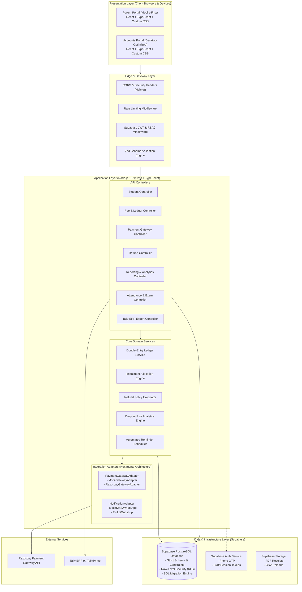
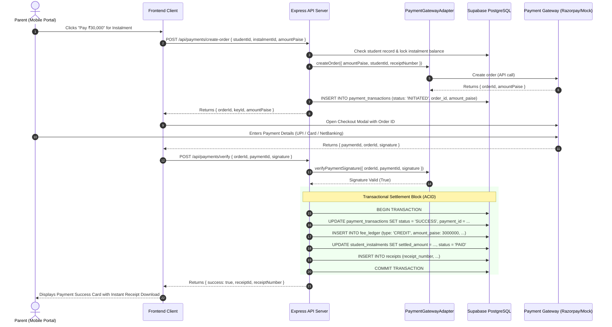

# SYSTEM ARCHITECTURE SPECIFICATION
**Project:** Coaching Institute Fee Tracking System & Parent Portal  
**Target:** Company A, Jaipur  
**Version:** 1.0.0 (Full-Stack Production Blueprint)  

---

## 1. High-Level System Architecture

The system follows a modern decoupled, layered architecture: a lightweight React + Vite Single Page Application (SPA) communicating over a secure RESTful API with an Express.js + TypeScript service, backed by Supabase PostgreSQL with Row Level Security (RLS) and Supabase Auth.



---

## 2. Frontend Architecture (React + TypeScript + Vite)

### 2.1 Design Philosophy & Aesthetics
- **Visual Reference**: Alwayzz-inspired ultra-minimalist, typographic aesthetic.
- **Color Palette**:
  - Primary Surface: `#FFFFFF` (Pure White).
  - Background Secondary: `#F9FAFB` (Subtle Warm Gray).
  - Borders: `#E5E7EB` (Hairline crisp borders, `1px solid`).
  - Text Primary: `#111827` (Deep Ink Black).
  - Text Secondary: `#6B7280` (Muted Neutral Slate).
  - Brand & Status Accent: `#17C964` (Restrained, high-contrast Emerald Green for paid states, success banners, active milestones).
  - Warning Accent: `#F5A524` (Amber for upcoming dues).
  - Critical Accent: `#F31260` (Crimson for overdue / dropout risk).
- **Typography**:
  - Font Family: `Inter, -apple-system, BlinkMacSystemFont, "Segoe UI", Roboto, sans-serif`.
  - Headings: Bold weights (`600`, `700`) with tight negative letter-spacing (`-0.025em` to `-0.035em`).
  - Data / Tables: Clean tabular numerical alignment (`font-variant-numeric: tabular-nums`).
- **Styling Architecture**: Scoped **Custom CSS** and CSS custom properties (`:root` theme tokens) located in `/src/styles/`. **Zero Tailwind CSS utilities**.

### 2.2 Layout Strategy & Responsive Paradigms
- **Parent Portal (Mobile-First)**:
  - Optimized for smartphone viewports (360px–480px width) with bottom navigation tabs, large tactile touch targets (minimum 44x44px), card summaries, and full-screen payment sheets.
- **Accounts Portal (Desktop-Optimized)**:
  - High-density data grid layout optimized for 1280px+ desktop monitors.
  - Multi-column filters (Centre, Batch, Due Date Range, Payment Status, Risk Flag).
  - Inline actions, quick keyboard shortcuts, drawer modals for detailed audit trails.

### 2.3 Frontend Directory Architecture
```
frontend/
├── index.html
├── package.json
├── tsconfig.json
├── vite.config.ts
├── public/
│   ├── favicon.ico
│   └── brand/
└── src/
    ├── main.tsx
    ├── App.tsx
    ├── routes/
    │   ├── AppRoutes.tsx
    │   ├── ProtectedRoute.tsx
    │   └── RoleGuard.tsx
    ├── styles/
    │   ├── variables.css      # CSS tokens (colors, typography, spacing, shadows)
    │   ├── global.css         # Reset, base typography, scrollbars
    │   ├── layout.css         # App shell, sidebar, mobile navigation
    │   └── components.css     # Buttons, badges, tables, modal overlays
    ├── components/
    │   ├── common/            # Button, Input, Modal, Badge, Dropdown, StatCard
    │   ├── parent/            # FeeTimeline, ReceiptCard, AttendanceGauge, TestScoreCard
    │   └── accounts/          # AgeingMatrix, LedgerTable, UnmatchedQueue, RefundModal
    ├── pages/
    │   ├── auth/              # ParentLogin, StaffLogin, OtpVerification
    │   ├── parent/            # ParentDashboard, FeeDetails, PaymentPage, AcademicView
    │   └── accounts/          # Dashboard, StudentsList, StudentDetail, Ledgers, Refunds, TallyExport
    ├── hooks/                 # useAuth, useStudent, useLedger, usePayment
    ├── services/              # apiClient, authService, paymentService, exportService
    ├── types/                 # Domain DTOs and TypeScript interfaces
    └── utils/                 # Currency formatters (paise to INR), date formatters
```

---

## 3. Backend Architecture (Node.js + Express + TypeScript)

### 3.1 Layered & Hexagonal Architecture
The backend strictly isolates business logic from transportation frameworks and external third-party SDKs:
1. **Transport Layer (`controllers/`, `routes/`)**: Handles HTTP requests, extracts parameters, invokes validators, and maps service outputs to HTTP status codes.
2. **Validation Layer (`validators/`)**: Pure Zod schemas validating request payloads, queries, and URL parameters before hitting business logic.
3. **Domain Service Layer (`services/`)**: Encapsulates all business rules:
   - Double-entry ledger postings.
   - FIFO instalment allocations.
   - Refund policy calculations.
   - Dropout risk evaluation.
   - Reminder scheduling and escalation.
4. **Integration Layer (`adapters/`)**: Pluggable interfaces for external systems:
   - `PaymentGatewayAdapter`: Decoupled payment processing (Mock vs. Razorpay).
   - `NotificationAdapter`: Decoupled messaging (Mock vs. SMS/WhatsApp).
5. **Persistence Layer (`repositories/` or direct Supabase client)**: Type-safe SQL query builders and transactions interacting with PostgreSQL.

### 3.2 Pluggable Payment Adapter Contract

```typescript
export interface CreateOrderParams {
  amountPaise: number;
  studentId: string;
  instalmentId?: string;
  receiptNumber: string;
  notes?: Record<string, string>;
}

export interface PaymentOrderResult {
  orderId: string;
  amountPaise: number;
  currency: 'INR';
  gatewayKeyId: string;
  adapterName: 'MOCK' | 'RAZORPAY';
}

export interface VerifySignatureParams {
  orderId: string;
  paymentId: string;
  signature: string;
}

export interface RefundParams {
  paymentId: string;
  amountPaise: number;
  reason: string;
}

export interface PaymentGatewayAdapter {
  createOrder(params: CreateOrderParams): Promise<PaymentOrderResult>;
  verifyPaymentSignature(params: VerifySignatureParams): Promise<boolean>;
  fetchPayment(paymentId: string): Promise<PaymentDetails>;
  initiateRefund(params: RefundParams): Promise<RefundResult>;
  verifyWebhookSignature(rawBody: string, signature: string): boolean;
}
```

- In local development and automated CI, `MockGatewayAdapter` returns instant deterministic tokens, enabling full end-to-end checkout simulations without live API keys.
- In production, `RazorpayGatewayAdapter` issues live test/prod Razorpay Orders and verifies HMAC SHA256 signatures.

---

## 4. Payment Execution & Settlement Sequence



---

## 5. Security & Isolation Architecture

1. **Database Row Level Security (RLS)**:
   - Supabase RLS policies guarantee data isolation at the database engine level.
   - A parent authenticated with phone number $P$ cannot view or modify students or ledgers associated with phone number $Q$.
2. **Strict Webhook Authentication**:
   - Razorpay webhook payloads are authenticated using the shared webhook secret.
   - The server computes `crypto.createHmac('sha256', secret).update(rawPayload).digest('hex')` and validates using constant-time comparison `crypto.timingSafeEqual`.
3. **Idempotency Keys**:
   - Webhook transactions record the incoming `event_id` in a dedicated `payment_webhook_events` table with a unique constraint. Duplicate deliveries are acknowledged with HTTP 200 without duplicate processing.
4. **Input Validation**:
   - All controller endpoints pass incoming payloads through strict Zod schemas that reject unknown fields, enforce integer paise bounds, and sanitize strings.

