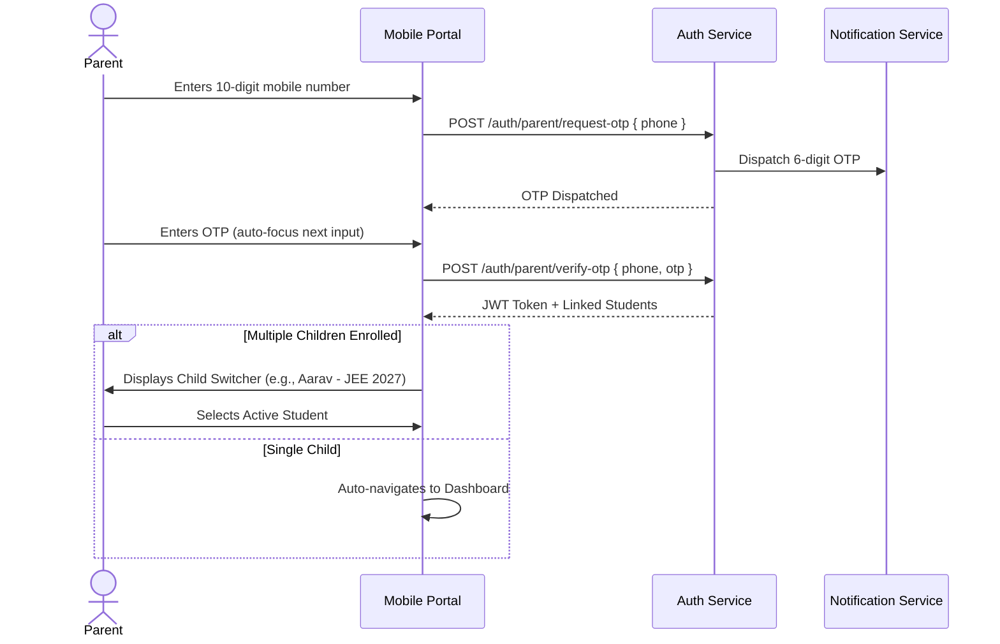
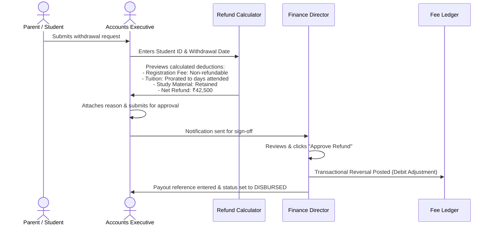

# USER WORKFLOWS & INTERACTION LIFECYCLES
**Project:** Coaching Institute Fee Tracking System & Parent Portal  
**Target:** Company A, Jaipur  
**Version:** 1.0.0 (Production UX & Operational Workflows)  

---

## 1. Parent Experience Workflows (Mobile-First)

### 1.1 Authentication & Multi-Student Selection


### 1.2 Fee Inspection & "One-Tap Pay" Workflow
1. **At-a-Glance Dashboard**:
   - Parent arrives on a clean, high-contrast dashboard.
   - Prominent status card:
     - **Green Banner** (`#17C964`) if all dues are cleared.
     - **Stark Black / Amber Banner** if an instalment is upcoming (`DUE IN 5 DAYS`).
     - **Crimson Highlight** (`#F31260`) if an instalment is overdue (`OVERDUE BY 12 DAYS`).
   - Displays: Total Net Fee, Total Paid, Remaining Dues, and Next Due Date.
2. **Instalment Breakdown Drawer**:
   - Tapping "View All Instalments" opens a timeline view showing 3–4 milestones with status badges:
     - Milestone 1: ₹30,000 — `PAID` (Green checkmark, "View Receipt" button).
     - Milestone 2: ₹30,000 — `DUE 2026-10-10` (High-contrast "Pay ₹30,000 Now" button).
     - Milestone 3: ₹30,000 — `UPCOMING 2027-01-15`.
     - Milestone 4: ₹30,000 — `UPCOMING 2027-04-10`.
3. **Checkout Experience**:
   - Parent taps "Pay Now".
   - Can pay full instalment balance or toggle "Pay Custom / Partial Amount".
   - Payment sheet opens with Razorpay / Mock Gateway interface (UPI Apps: GPay, PhonePe, Paytm, or Cards/NetBanking).
   - Upon completion, the screen transitions immediately to a success state with a printable, verified receipt.

### 1.3 Attendance & Academic Report Card Inspection
1. **Attendance Tab**:
   - Displays overall monthly percentage gauge (e.g. 92.3% Present).
   - Monthly calendar grid highlighting Present (neutral dot), Absent (red circle), and Excused (amber dot).
2. **Test Scores Tab**:
   - Replaces fragmented WhatsApp PDFs.
   - Chronological list of mock tests (e.g. `JEE Advanced Full Mock 1`).
   - Detailed breakdown cards showing Physics, Chemistry, Maths/Biology scores, Batch Rank, and Percentile.

---

## 2. Accounts Executive Workflows (Desktop-Optimized)

### 2.1 Daily Morning Command Centre & Ageing Inspection
1. **Executive KPI Review**:
   - Total Collected vs. Target for current quarter.
   - Critical Overdue Count (>30 days).
   - Unmatched Bank Transactions counter.
2. **Ageing Buckets Matrix**:
   - Clickable drilldown into 0–15d, 16–30d, 31–60d, and 60+d ageing tiers.
   - One-click action to filter the student list by selected bucket.

### 2.2 Student Account Deep-Dive & Fee Ledger
```mermaid
flowchart TD
    Search[Accounts Executive searches 'STU-0587' or 'Ishita'] --> Detail[Student 360° Profile]
    Detail --> Summary[Fee Summary: ₹1,20,000 Fee | ₹15,000 Paid | ₹15,000 Overdue]
    Detail --> LedgerTab[Fee Ledger Tab]
    LedgerTab --> ViewTx[Inspects Append-Only Ledger: Debit ₹30,000 Fee | Credit ₹15,000 Payment]
    Detail --> Actions{Actions Menu}
    Actions --> OfflinePay[Record Offline Payment]
    Actions --> RefundReq[Initiate Refund Calculator]
    Actions --> SendRem[Trigger Instant Reminder]
```

### 2.3 Recording Offline Payments (Cash, Cheque, DD, NEFT)
1. Accounts Executive clicks **"Record Offline Payment"**.
2. Selects payment instrument:
   - **Cash**: Instant settlement, generates official cash receipt voucher.
   - **Cheque / Demand Draft**: Enters Cheque Number, Bank Name, Branch, and Cheque Date. Status set to `PENDING_CLEARANCE`.
   - **NEFT / RTGS**: Enters Bank UTR number.
3. System verifies allocation: allocates to oldest overdue instalment via FIFO.
4. Generates unique sequential receipt number `REC-{YEAR}-{CENTRE}-{SEQ}` for physical print or WhatsApp dispatch.

### 2.4 Unmatched Payment Reconciliation
1. Accounts Executive navigates to **"Unmatched Bank Queue"**.
2. Rows populated by daily bank statement uploads containing unmatched credits.
3. Executive searches student roll number, confirms amount matches, and clicks **"Match & Allocate"**.
4. The system automatically converts the unmatched item into an authorized payment transaction, posts credit to the student's ledger, and settles corresponding instalments.

### 2.5 Refund Processing Workflow


### 2.6 Tally ERP 9 / TallyPrime Export
1. Executive selects accounting period (e.g. `2026-10-01` to `2026-10-31`).
2. Clicks **"Generate Tally XML"**.
3. System validates that all receipts have matching ledger entries.
4. Downloads standard XML file formatted with `<VOUCHER>` tags, ready to import directly via `Tally -> Import Data -> Vouchers`.

---

## 3. Edge Cases & Resilience Strategies

| Scenario / Edge Case | Failure Mode / Risk | Architectural Mitigation Strategy |
| :--- | :--- | :--- |
| **Parent abandons checkout modal** | Ghost transaction remains in pending state. | Payment transaction marked `INITIATED`. Gateway timeout webhook or 30-minute expiry job marks it `USER_DROPPED`. Instalment balance is not deducted until confirmed. |
| **Double Payment via Concurrent Devices** | Both parents pay at the same time via different phones. | Database-level row locking (`SELECT FOR UPDATE`) on `student_instalments`. Second transaction detects milestone already settled; excess funds automatically routed to next scheduled instalment or tagged as `UNALLOCATED_ADVANCE`. |
| **Cheque Bounce / Dishonour** | Cheque bounced after provisional receipt was issued. | Reversal transaction posted to `fee_ledger` as a `DEBIT` adjustment with reason `CHEQUE_BOUNCED`. Instalment reverts to `OVERDUE`. Receipt is flagged `VOID / BOUNCED`. |
| **Network Failure during Webhook** | Webhook callback from Razorpay fails or drops. | Idempotent reconciliation poller queries gateway API every 15 minutes for transactions stuck in `INITIATED` status older than 10 minutes. |
| **Partial Underpayment** | Parent enters ₹5,000 for a ₹30,000 instalment. | System accepts partial payment, credits ₹5,000 to ledger, updates instalment status to `PARTIALLY_PAID` with remaining balance ₹25,000, and generates an official partial receipt. |
| **Disputed Refund Calculation** | Parent claims they stopped attending earlier than date recorded. | Executive can inspect daily attendance logs directly within the refund calculation view to corroborate claims before overriding deductions. All overrides require mandatory justification notes. |

